# Bài 1 - Cơ sở lập trình bảo mật, kiểm tra đầu vào

Bài làm theo lab-01.pdf, gồm phần 1.2 SecureValidator, 1.4 GitSecure và 1.6 SecureLogger. Theo yêu cầu của người dùng, dùng kho GitHub hiện tại thay cho tạo kho MSSV riêng.

Ngày thực hiện: 28/10/2026. Mã nguồn kiểm chứng: commit `128a2bc`.

- [Website đã triển khai](https://securevalidator-bunnguyen04.onrender.com/)
- [CI đã chạy thành công](https://github.com/Punnicolai/ThucHanhSangThu4/actions/runs/40621204197)
- Tổng cộng 30 test method (17 validator, 7 hook, 6 logger), kèm các demo commit và API.

Các ảnh dưới đây chụp trực tiếp từ Render, ứng dụng đang chạy và GitHub Actions. Không dựng terminal hoặc thay nội dung kết quả. Thời gian trong JSON dùng UTC; 02:29 UTC tương ứng 09:29 giờ Việt Nam.

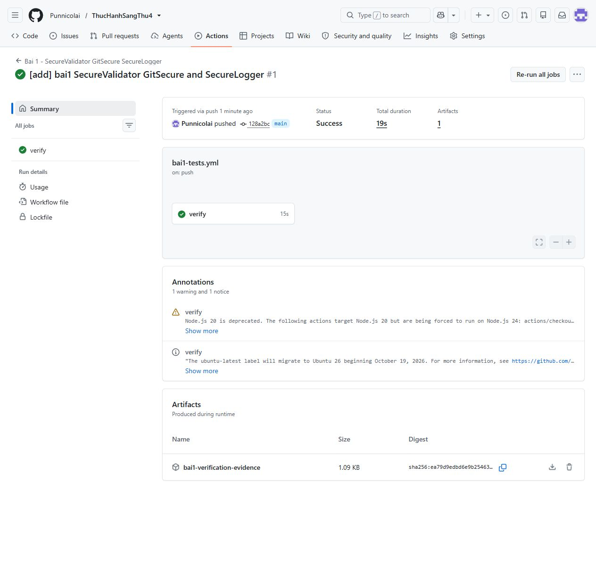

## 1. SecureValidator

```powershell
cd "C:\Users\bunng\Downloads\sang thu 4\bai1\secure-validator-lab"
python -m pip install -r requirements.txt
python -m unittest discover tests -v
python app.py
```

Mở http://127.0.0.1:5000/. Nhập user@example.com, https://8.8.8.8/, report.pdf, chuỗi SQL `' OR 1=1 --` và HTML `<script>alert(1)</script>`. Thử lại URL http://127.0.0.1 và tên tệp ../secret.txt để thấy bị từ chối.

Kết quả trên CI: `Ran 17 tests in 0.152s`, `OK`.

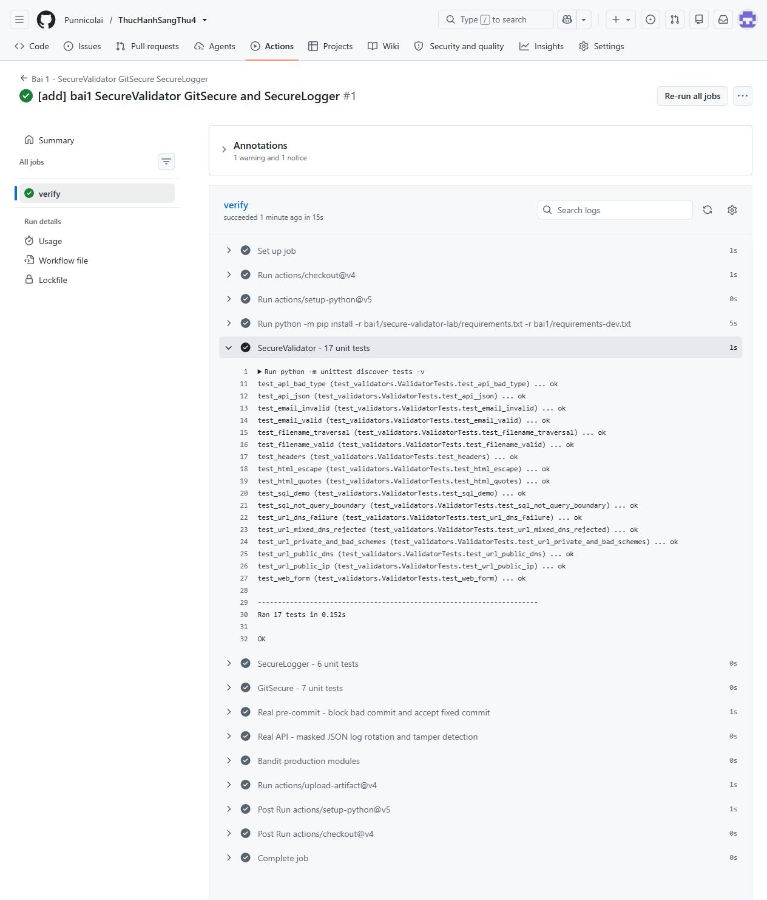

### Thử trên giao diện thật

Mở URL Render, nhập dữ liệu hợp lệ rồi nhấn **Kiểm tra dữ liệu**. Ảnh có email, URL và tên tệp đều True.

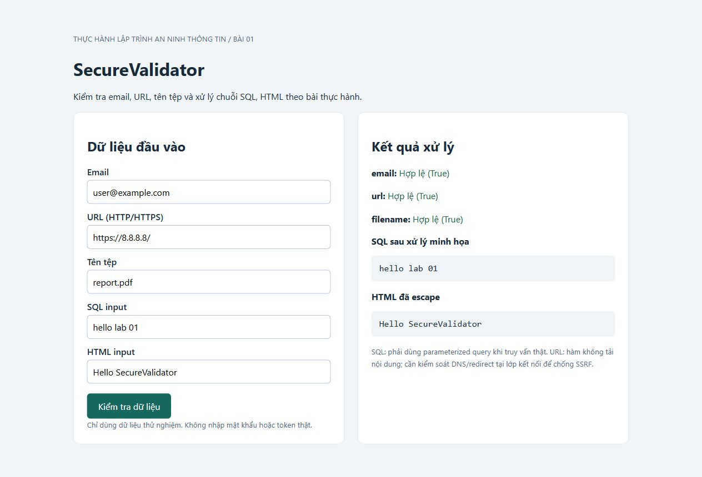

Đổi email thành `user@@example..com`, URL thành `http://127.0.0.1`, tên tệp thành `../secret.txt`. Kết quả cả ba là False.


Request chứa đồng thời chuỗi SQL injection/XSS trên URL public đã bị WAF của Render trả 403 trước khi tới Flask. Phần xử lý payload trong mã ứng dụng được kiểm chứng riêng bằng unit test và Flask test client trên CI (ảnh phần SecureLogger). Không hạ WAF hoặc trình bày 403 như kết quả của validator.

Bộ kiểm thử hiện có 17 test method, bao gồm nhiều subtest hợp lệ và độc hại. Hàm URL không tải nội dung. DNS được kiểm tra tất cả địa chỉ trả về; ứng dụng thực hiện HTTP thật vẫn phải kiểm soát kết nối/redirect để tránh DNS rebinding. Không coi blacklist SQL là cách chống SQL injection: phải dùng truy vấn có tham số. HTML được escape theo ngữ cảnh văn bản, không dùng Jinja safe.

## 2. GitSecure pre-commit

Từ gốc kho:

```powershell
python -m pip install -r bai1/requirements-dev.txt
python -m unittest discover -s bai1/gitsecure/tests -v
python bai1/tools/hook_demo.py
```

Script dùng kho Git tạm riêng: stage dữ liệu credential giả, thử git commit (bị hook chặn), sửa sang biến môi trường rồi commit lại (thành công). Không đưa bad.py có credential giả vào lịch sử kho chính. Kết quả thật lưu tại docs/evidence/hook-demo.json.

Trong [log CI thực tế](https://github.com/Punnicolai/ThucHanhSangThu4/actions/runs/40621204197/job/122595410724), lần commit đầu trả mã 1 với `COMMIT BLOCKED by GitSecure` và Bandit B105 LOW. Sau sửa, mã trả về 0 và `GitSecure: All checks passed.`. Commit minh họa trong kho tạm của runner là `219208e`.

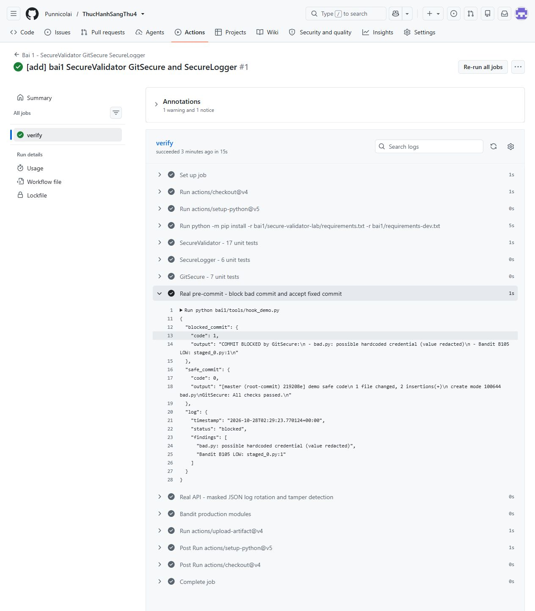

Để bật hook cho kho này, xem gitsecure/README.md. Chưa tự thay core.hooksPath của kho chính vì kho còn các bài khác. Hook phân tích snapshot đã stage, chạy Bandit, kiểm tra quyền POSIX và policy giấy phép dependency trực tiếp. Trên Windows, demo thay shebang trong kho tạm bằng đường dẫn Python đang chạy để tránh phụ thuộc env.exe; logic hook không đổi.

## 3. SecureLogger và API

```powershell
cd "C:\Users\bunng\Downloads\sang thu 4\bai1\secure_logger_lab"
python -m pip install -r requirements.txt
python -m unittest discover tests -v
python app.py
```

API chạy cổng 5001 để không trùng app phần trước. Trong Postman chọn POST http://127.0.0.1:5001/validate, Body > raw > JSON:

```json
{"email":"user@example.com","url":"https://8.8.8.8/","filename":"report.pdf","sql":"' OR 1=1 --","html":"<script>alert(1)</script>"}
```

Có thể import `postman_collection.json` vào Postman, chọn hai request và nhấn Send. Ảnh minh chứng API trong báo cáo là log chạy **Flask test client trên CI**, không phải ảnh Postman.

Từ gốc kho, có thể chạy demo API thực bằng Flask test client:

```powershell
python bai1/tools/logger_demo.py
```

Demo gửi request POST qua Flask, đọc log JSON đã che email/token, kiểm tra HMAC trước và sau sửa log, tạo hai archive gzip và xác minh archive. Kết quả lưu tại docs/evidence/logger-demo.json. Bộ test logger có 6 method; GitSecure có 7 method.

Kết quả API trên CI: HTTP 200; SQL thành `1=1`; HTML thành `&lt;script&gt;alert(1)&lt;/script&gt;`. Phần `masked_log` có email `<email_masked>` và token `<redacted>`. Dữ liệu request trong demo đều là dữ liệu giả phục vụ kiểm thử.

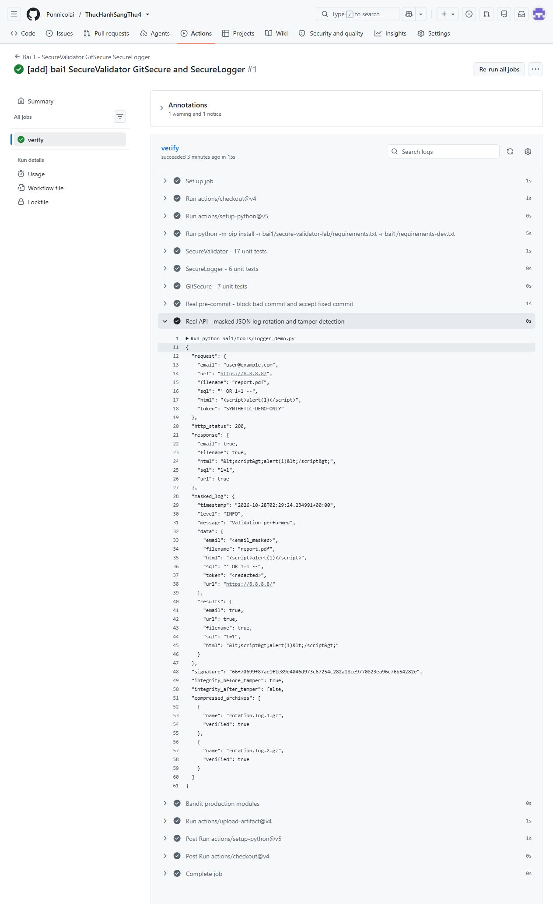

Sau khi sửa nội dung log: `integrity_before_tamper: true`, `integrity_after_tamper: false`. Hai archive `rotation.log.1.gz`, `rotation.log.2.gz` đều `verified: true`.

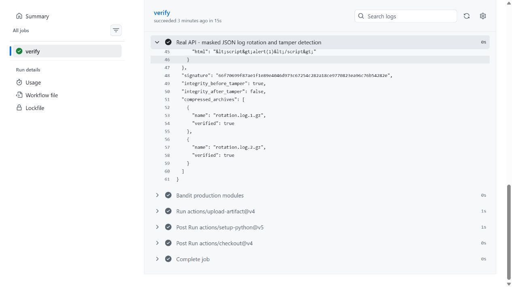

Log thực nằm trong logs/ và được gitignore. HMAC cần khóa riêng bảo vệ ngoài log. Nếu không đặt LOG_INTEGRITY_KEY, chương trình tạo khóa ngẫu nhiên trong logs/.integrity.key chỉ cho demo cục bộ. HMAC không ngăn xóa cả phần cuối log lẫn signature tương ứng nếu không có checkpoint tin cậy bên ngoài. Bản này dành cho một tiến trình; triển khai nhiều worker cần dịch vụ ghi log tập trung. Sidecar có đuôi .sig là chuỗi HMAC, không phải chữ ký số bất đối xứng.

## 4. Deploy Render

Dùng New > Web Service, chọn Public Git Repository và URL kho hiện tại. Chọn branch main, runtime Python, Root Directory `bai1/secure-validator-lab`, Build Command `pip install -r requirements.txt`, Start Command `gunicorn --bind 0.0.0.0:$PORT --workers 1 app:app`, Instance Type Free. Kiểm tra URL được Render cấp và thử dữ liệu trên giao diện.

Ảnh cấu hình được chụp trước khi Deploy, đã chọn **Python 3**, thư mục đúng và compute **$0/month**.

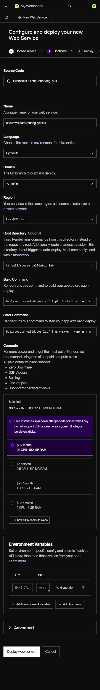

Dịch vụ `securevalidator-bunnguyen04` triển khai commit `128a2bc` thành công ngày 28/10/2026 lúc 09:30, duration 46.2 giây. Render dùng Python 3.14.8, còn CI dùng Python 3.12.15.

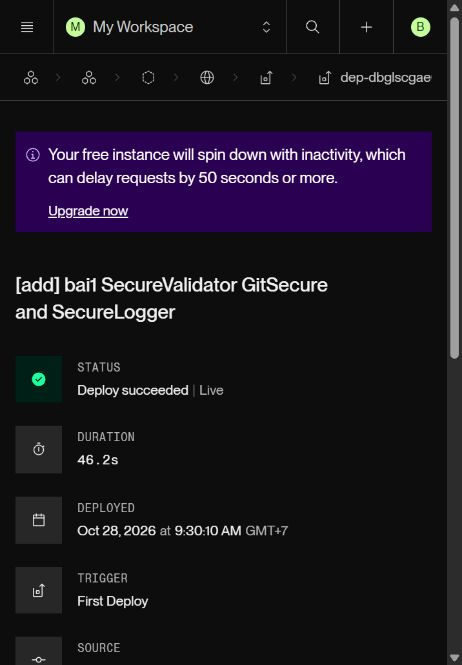

Cấu hình Blueprint ở bai1/render.yaml có rootDir phù hợp kho nhiều bài. Khi tạo Blueprint, đặt Blueprint Path là bai1/render.yaml. Đã mở **New > Blueprint**, nhập URL kho public, đặt Blueprint Name `lab01-securevalidator-blueprint` và Blueprint Path `bai1/render.yaml`. Render đọc được YAML và nhận diện dịch vụ hiện có. Chọn **Associate existing services** rồi **Deploy Blueprint**, thay vì tạo bản trùng.

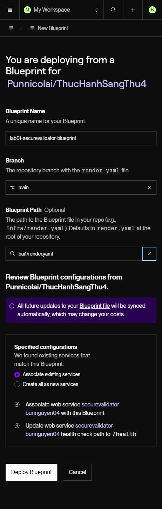

Trạng thái sync cuối được ghi nhận trong ảnh sau.

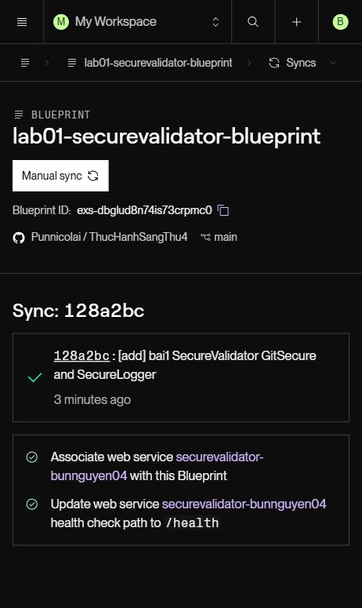

## 5. Kiểm tra tự động trên GitHub Actions

Mở GitHub > Actions > **Bai 1 - SecureValidator GitSecure SecureLogger** > lần chạy #1 > verify. Workflow đã chạy thành công trong 19 giây; job verify mất 15 giây. Có artifact `bai1-verification-evidence` chứa kết quả hai demo.

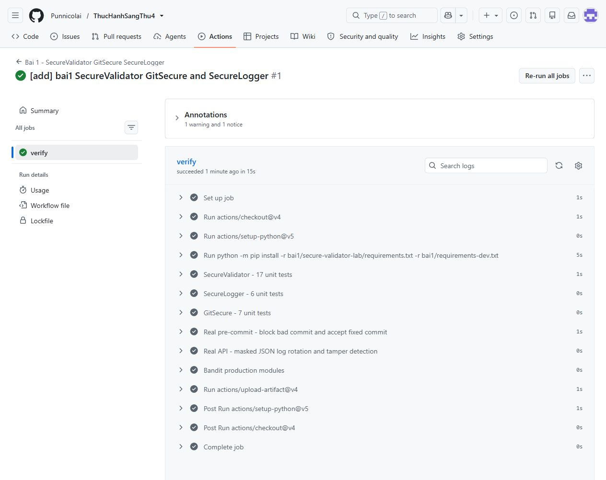

Bước Bandit quét 332 dòng mã trong các module ứng dụng/hook, không quét thư mục tests và tools minh họa. Kết quả `No issues identified`, Low/Medium/High đều 0. Có 4 cảnh báo tiềm năng bị suppress có chủ đích bằng `nosec` cho import/chạy subprocess với argv cố định trong hook; không dùng shell=True. Kết quả này không chứng minh mã không có lỗ hổng.

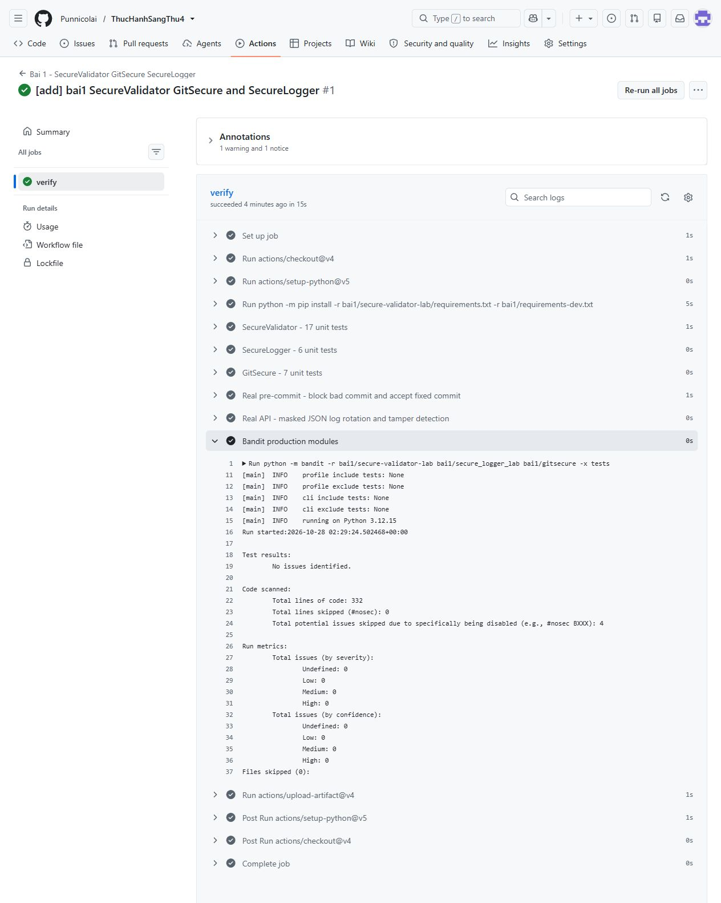

## 6. Đẩy bài và báo cáo lên GitHub

Từ gốc kho:

```powershell
git status
git add -- bai1 .github/workflows/bai1-tests.yml
git commit -m "Complete lab 01 with real screenshots"
git push origin main
```

Không commit venv, log thật, khóa HMAC hoặc thông tin xác thực. Các JSON trong docs/evidence là kết quả chạy với dữ liệu thử tổng hợp. Bản chạy tại máy có timestamp/commit demo khác runner CI; có thể đối chiếu ảnh với URL CI phía trên.

## Điều chỉnh so với mẫu

- URL chặn IP nội bộ, loopback, link-local, userinfo và cổng ngoài policy.
- Tên tệp chặn encoding, đường dẫn Windows và tên thiết bị.
- Không bật Flask debug.
- Hook kiểm tra nội dung đã stage thay cho đọc bản chưa stage; Bandit lỗi sẽ chặn commit.
- Logger dùng HMAC và xác minh thật, xoay cả log cùng sidecar, che PII trong cấu trúc lồng nhau.
- Quyền POSIX không tương đương Windows ACL; kiểm tra giấy phép chưa bao phủ phụ thuộc gián tiếp.

## Tài liệu

- https://render.com/docs/deploy-flask
- https://render.com/docs/blueprint-spec
- Đề lab-01.pdf, các phần 1.2, 1.4 và 1.6.
