# Bài 3: Bảo mật mạng máy tính

Thực hiện theo `lab-03.pdf`: SecureChat, NetRecon và báo cáo thao tác. Chạy thử bằng socket thật trên `127.0.0.1`; các cổng được cấp động trong kiểm thử để tránh trùng dịch vụ.

Ngày thực hiện: **28/10/2026**. Kho mã: [ThucHanhSangThu4/bai3](https://github.com/Punnicolai/ThucHanhSangThu4/tree/main/bai3). Mã nguồn chạy kiểm chứng: commit `2beee8a`.

Ảnh 01–07 chụp trực tiếp từ GitHub Actions của [lần chạy #1 đã thành công](https://github.com/Punnicolai/ThucHanhSangThu4/actions/runs/40647168733). Ảnh 08–11 do Chromium chụp giao diện Flask đang chạy trên runner CI trong [lần chạy #4 thành công](https://github.com/Punnicolai/ThucHanhSangThu4/actions/runs/40647785588), sau khi thực sự gửi form. Không dùng ảnh trong slide làm kết quả thực hành. Socket mạng đều là socket thật; Flask test client được dùng riêng trong nhóm kiểm tra HTTP.

Artifact ảnh tải về có SHA-256 `0bc737b149e5b727c542e4c04c0d0a3af9c670707e65dc288b48bc5387faec2a`, trùng digest GitHub công bố. Ảnh được giữ nguyên từ artifact.

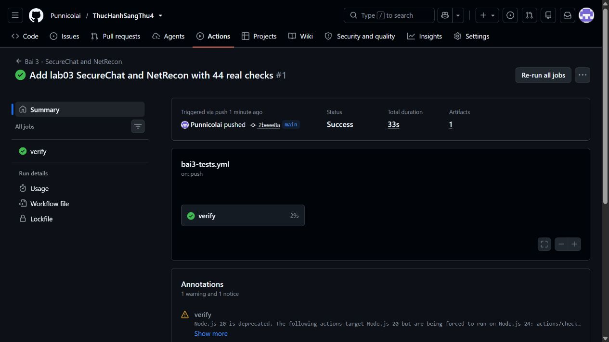

## 1. Chuẩn bị

Mở PowerShell trong thư mục kho mã:

```powershell
cd "C:\Users\bunng\Downloads\sang thu 4"
python -m venv bai3/.venv
bai3/.venv/Scripts/Activate.ps1
python -m pip install -r bai3/requirements.txt
```

Python 3.12 trở lên. Nếu PowerShell chặn kích hoạt, dùng trực tiếp `bai3/.venv/Scripts/python.exe` thay cho `python` trong các lệnh dưới.

## 2. SecureChat: tạo chứng chỉ

```powershell
cd bai3/secure-chat
python make_certs.py
python client.py --generate-key
```

`make_certs.py` tạo CA riêng, chứng chỉ server có SAN `localhost`/`127.0.0.1`, chứng chỉ client riêng cho `alice`, `bob`, `carol`. Đây là cách tạo chứng chỉ bằng thư viện cryptography, thay cho yêu cầu cài OpenSSL hệ thống của slide. Có thể nhấp chạy `make-certs.bat` trên Windows. Không chạy lại vào thư mục chứng chỉ đã tồn tại.

`room.key` là khóa AES 256 bit dùng riêng giữa các client của phòng. Server không đọc hoặc nhận khóa này. Trong bài chạy trên một máy, các client đọc cùng tệp; khi triển khai nhiều máy cần chuyển khóa cho đúng người bằng kênh riêng. Từng phòng nên dùng khóa riêng.

## 3. Chạy server và hai client

Mở ba cửa sổ PowerShell, kích hoạt môi trường và vào `bai3/secure-chat` ở mỗi cửa sổ.

**Cửa sổ 1:**

```powershell
python server.py
```

**Cửa sổ 2:**

```powershell
python client.py --user alice --room lobby
```

**Cửa sổ 3:**

```powershell
python client.py --user bob --room lobby
```

Gõ tin nhắn ở Alice, đọc ở Bob, rồi trả lời. Dùng `/join ten_phong` để chuyển phòng, `/quit` để thoát. Client kiểm tra CA và hostname; server bắt buộc client certificate. Danh tính lấy từ CN trong chứng chỉ, không tin username do client tự gửi.

Tin nhắn được mã hóa AES-GCM tại client, kèm room/sender làm authenticated data. Server chuyển ciphertext đến thành viên cùng phòng. Mỗi frame có tiền tố độ dài và giới hạn 64 KiB; có khóa đồng bộ quản lý kết nối, phòng và thao tác gửi.

### Kết quả thực tế của SecureChat

Trong log CI, Alice kết nối bằng **TLSv1.3**, Bob nhận `Xin chao Bob, day la tin nhan bao mat!` và trả lời thành công. Server chỉ lưu ciphertext trong transcript. Carol ở phòng khác không nhận được tin lobby; chuyển phòng được xác nhận.

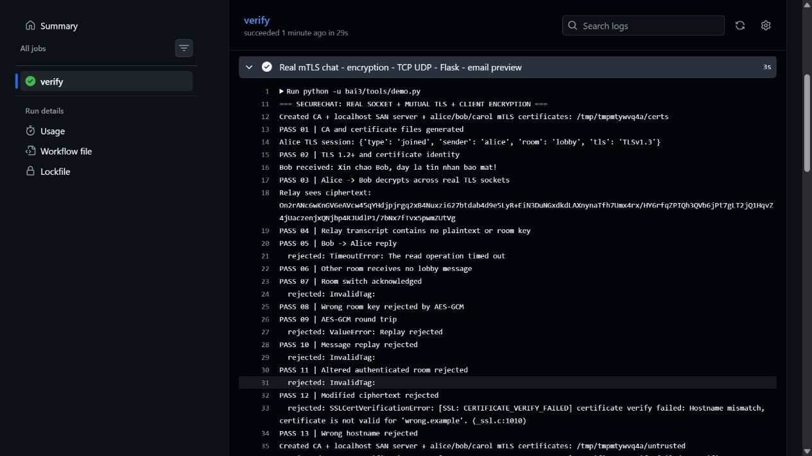

Kiểm thử sửa ciphertext, đổi room authenticated data, dùng sai khóa và gửi lại message ID đều bị từ chối. Kết nối sai hostname, CA không tin cậy hoặc không có client certificate cũng bị chặn. Thông báo `rejected` trong ảnh là kết quả mong đợi của ca kiểm thử âm.

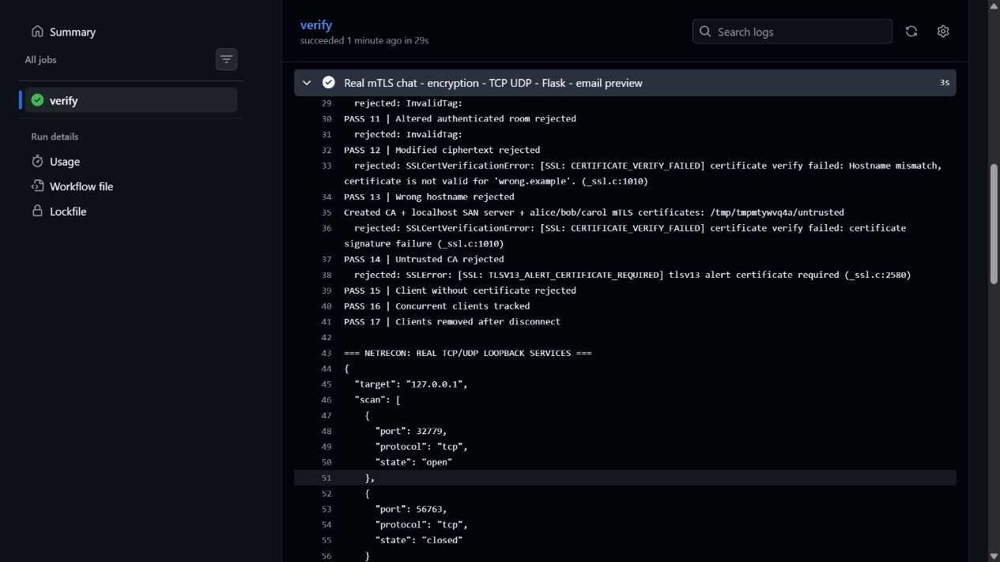

## 4. NetRecon: chạy dịch vụ mẫu do mình quản lý

Từ thư mục gốc kho mã, mở cửa sổ PowerShell riêng:

```powershell
python bai3/tools/serve_demo.py
```

Lệnh mở HTTP banner tại `127.0.0.1:8080`, UDP echo tại `127.0.0.1:9999`, giao diện tại `http://127.0.0.1:5000`.

## 5. NetRecon CLI

```powershell
cd bai3/netrecon
python cli.py --target 127.0.0.1 --ports 8080,8443 --mode all
python cli.py --target 127.0.0.1 --ports 9999 --protocol udp --mode scan
python cli.py --target 127.0.0.1 --ports 8080 --email-preview report.eml
```

`--mode` nhận `scan`, `service`, `banner`, `map`, `vuln`, `all`. `--rate-limit 10` giới hạn 10 probe/giây; tối đa 128 cổng mỗi lần. Có parser dải cổng như `8000-8010`.

TCP dùng connect scan. UDP chỉ kết luận `open` khi nhận phản hồi; im lặng là `open|filtered`. Firewall trên Windows có thể làm cổng không mở trả `filtered/unknown`. Chế độ quét ẩn mình trong mô tả đề không được triển khai; bản này dùng probe thông thường, không giả mạo hoặc né giám sát.

Whitelist mặc định `127.0.0.0/8`; blacklist ưu tiên hơn whitelist trong `filter_utils.py`. Nhập IP dạng số để tránh DNS rebinding. Không chạy các IP ngoài phạm vi thực hành. NetworkMapper chỉ mô tả host được chọn và các endpoint đã xác nhận mở, không thu thập ARP toàn mạng như mã mẫu.

Muốn nhận diện phiên bản bằng Nmap, cài từ trang chính thức [nmap.org](https://nmap.org/download.html), thêm Nmap vào PATH, rồi chạy:

```powershell
python cli.py --target 127.0.0.1 --ports 8080 --mode service --nmap
```

Lệnh gọi `nmap -sT -sV --version-light` với thời gian và tốc độ giới hạn. Khi không dùng Nmap, nhãn service chỉ là gợi ý theo số cổng; banner lấy từ kết nối thật. Mục vuln đưa ra điểm cần kiểm tra cấu hình, không gán CVE chỉ vì cổng đang mở.

### Kết quả CLI thực tế

Runner tìm thấy TCP `32779/open`, TCP `56763/closed`; banner HTTP trả `Server: Lab03Demo/1.0`. Các số cổng này được cấp động cho lần chạy #1, nên sẽ thay đổi khi chạy lại. Đây là các endpoint do script tự mở trên loopback, không phải máy bên ngoài.

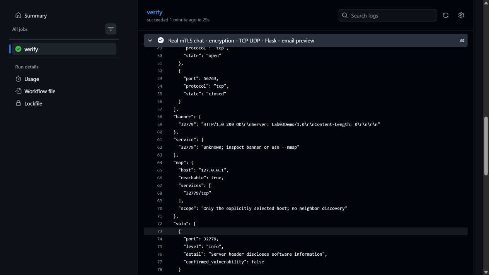

UDP echo `60293/udp` trả `open`. Socket UDP có bind nhưng không phản hồi trả `open|filtered`. Parser cổng, rate limit và policy địa chỉ có kiểm chứng riêng.

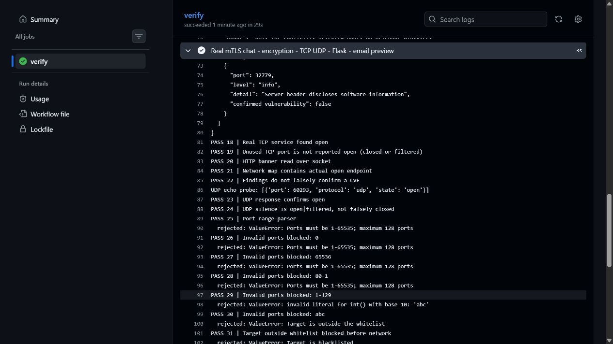

Nmap **7.94SVN** đã chạy thật với một host `127.0.0.1`, cổng `8080/tcp open`. Nmap ghi `tcpwrapped` cho dịch vụ mẫu trong lần này, nên **chưa nhận diện được phiên bản dịch vụ bằng Nmap**. Banner HTTP do module riêng thu được vẫn hiển thị `Lab03Demo/1.0`. Không diễn giải `tcpwrapped` thành chứng cứ có lỗ hổng.

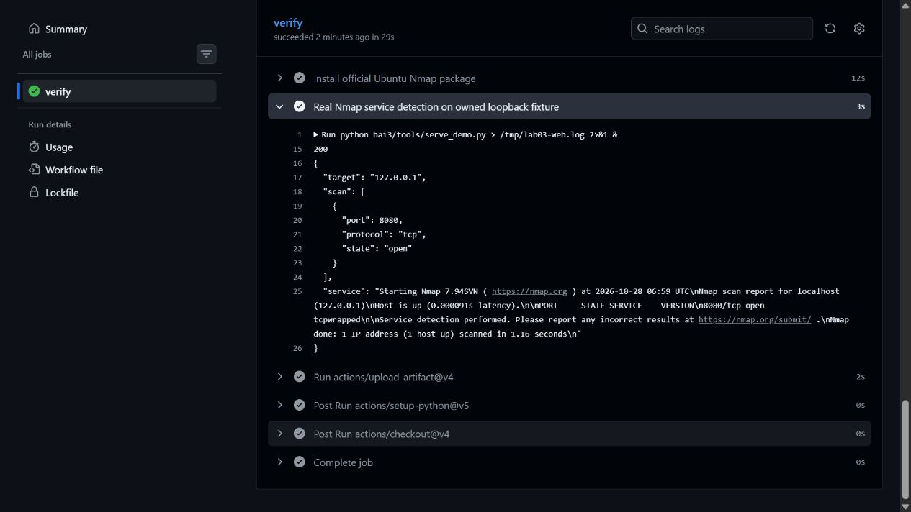

## 6. NetRecon giao diện web

Giữ `serve_demo.py` đang chạy. Truy cập `http://127.0.0.1:5000`, nhập:

| Trường | Giá trị |
|---|---|
| Target IP | `127.0.0.1` |
| Ports | `8080,8443` |
| Protocol | `TCP` |
| Mode | `all` |
| Probes / giây | `10` |

Nhấn **Scan**, xem bảng cổng và báo cáo JSON. Thử lại UDP với cổng `9999`. Thử `192.0.2.1` để quan sát whitelist từ chối trước khi mở kết nối. Nhấn **Tải email báo cáo (.eml)** để tải bản email xem trước.

### Ảnh thao tác trên giao diện đang chạy

Bước 1: mở trang chủ, kiểm tra IP, cổng, giao thức và mode.

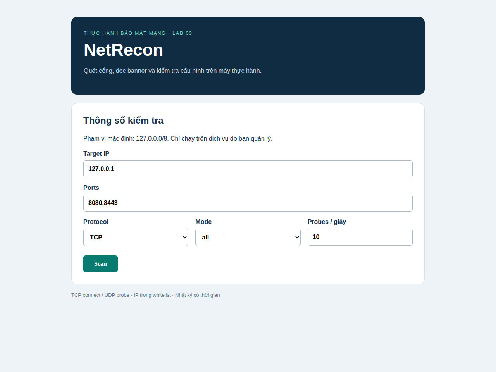

Bước 2: nhấn Scan với `127.0.0.1`, cổng `8080,8443`. Dịch vụ HTTP mẫu đang mở ở 8080; 8443 không có server trong lượt thử giao diện này. Bảng kết quả, banner và JSON được ứng dụng trả về sau quét.

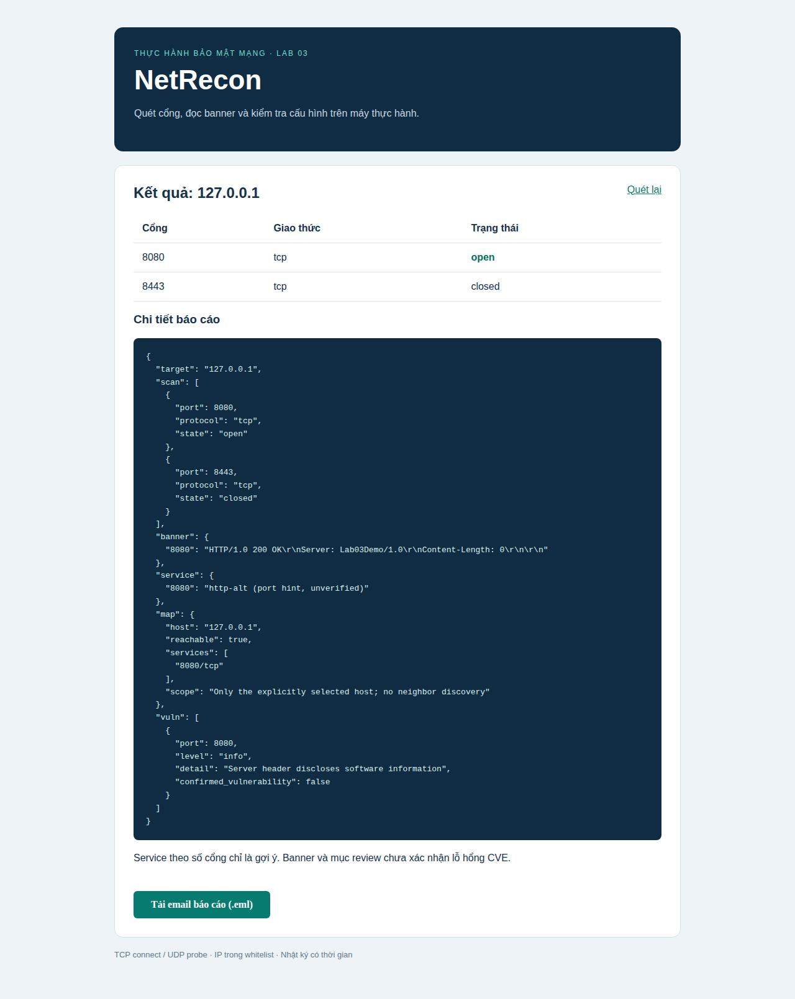

Bước 3: đổi Protocol sang UDP, cổng 9999. Dịch vụ echo phản hồi nên kết quả là open.

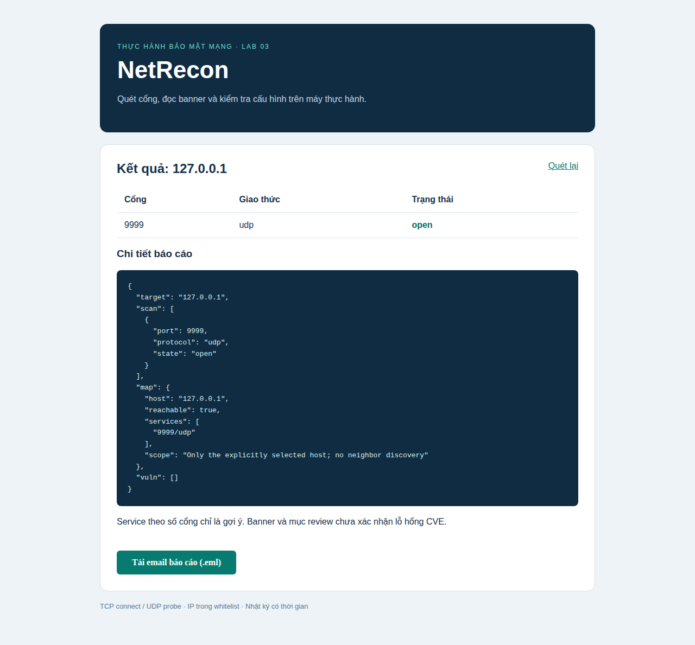

Bước 4: nhập `192.0.2.1`, nhấn Scan. Ứng dụng báo ngoài whitelist và trả HTTP 400; không thực hiện probe tới địa chỉ này. Sau lỗi, form trở về giá trị mặc định `127.0.0.1` như ảnh.

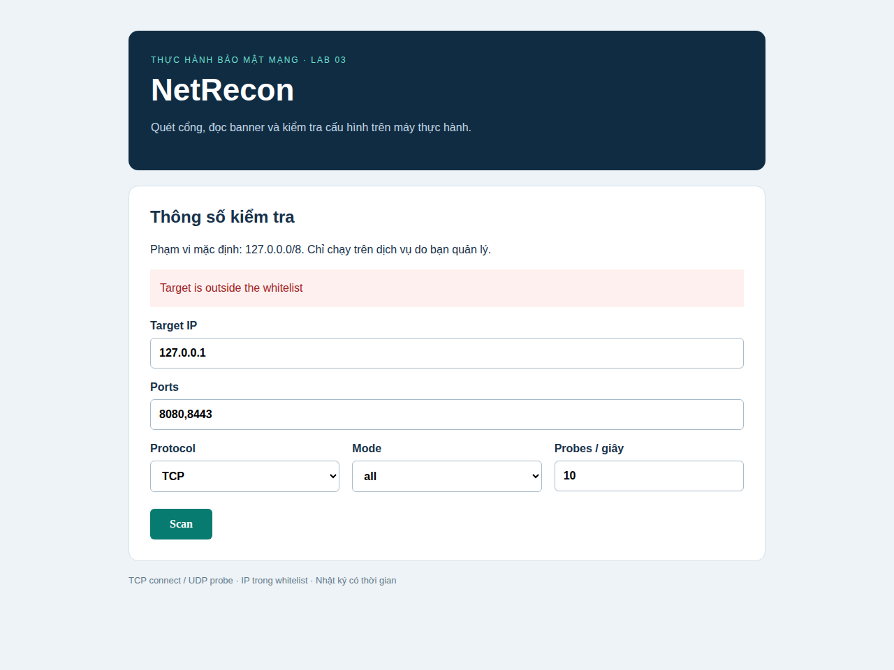

## 7. Email và nhật ký

Bản thực hành kiểm tra việc tạo email `.eml`; chưa gửi thư thật qua Gmail. Tệp `.env.example` cung cấp tên biến cấu hình SMTP. Nếu tự gửi sau này, sao chép thành `.env`, điền tài khoản/app password của bạn và dùng tùy chọn `--send-email dia_chi_nhan`. Không ghi mật khẩu trong mã hoặc đưa `.env` lên Git.

Hoạt động quét được ghi vào `netrecon.log` có timestamp. Private key, `certs/`, `room.key`, `.env`, log runtime và email cá nhân được loại khỏi Git.

## 8. Chạy toàn bộ kiểm chứng

Từ thư mục gốc kho mã:

```powershell
python bai3/tools/demo.py
```

Lần chạy trên Windows đã đạt **44/44 kiểm tra**, bao gồm TLS 1.3, trao đổi Alice/Bob, phân phòng, sai khóa, replay, sửa ciphertext, sai hostname, sai CA, thiếu client certificate, TCP/UDP thật, rate limit, whitelist/blacklist, Flask và email preview. Kết quả JSON ở `docs/evidence/verification.json`. Không dùng mock socket cho trao đổi mạng.

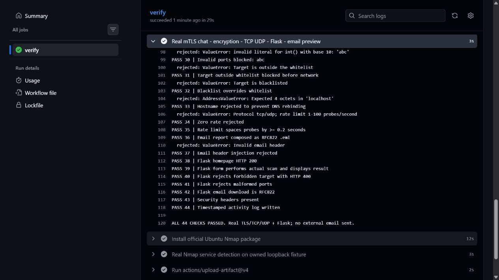

## 9. Đưa bài lên GitHub

```powershell
git add bai3 .github/workflows/bai3-tests.yml
git commit -m "Add lab03 SecureChat and NetRecon"
git push origin main
```

Mở **Actions → Bài 3 - SecureChat and NetRecon** để xem kiểm chứng trên Ubuntu. Báo cáo này kèm 11 ảnh minh chứng. Ảnh log dùng lần chạy #1; ảnh giao diện có nguồn từ artifact của lần chạy có bước Capture real NetRecon UI in Chromium.


## 10. Đối chiếu với đề và giới hạn thực hành

| Nội dung lab-03 | Phần thực hiện |
|---|---|
| SecureChatServer đa luồng | `secure-chat/server.py` |
| Client xác minh chứng chỉ | `secure-chat/client.py`, mTLS, CA và SAN |
| MessageEncryption | AES-256-GCM, khóa chỉ ở client |
| ConnectionManager / RoomManager | Hai module riêng, có khóa đồng bộ |
| TCP/UDP PortScanner | `modules/port_scanner.py`, TCP connect và UDP probe |
| ServiceDetector / BannerGrabber | Gợi ý cổng, tùy chọn Nmap, banner HTTP thật |
| NetworkMapper | Host được chọn và endpoint mở, phạm vi một host |
| VulnChecker | Gợi ý kiểm tra cấu hình, không xác nhận CVE |
| CLI / Flask / email | CLI đủ mode, form web, tải .eml; SMTP có opt-in |
| Rate limit / log / whitelist, blacklist | Có triển khai và kiểm chứng |

Khác với mẫu slide: tạo chứng chỉ bằng Python thay cho cài OpenSSL; dùng AEAD thay AES-CBC; không gửi khóa phòng cho server. Bản lab chưa có thu hồi chứng chỉ CRL/OCSP, cấp phát khóa nhóm tự động, đổi khóa khi thành viên rời phòng hoặc quản lý khóa nhiều máy. Client dùng cùng khóa phòng vẫn cần tin cậy các thành viên trong nhóm. Không coi đây là hệ thống chat sản xuất.

Phần scan dùng kết nối thông thường, không có chế độ quét ẩn mình; mapper không khám phá toàn bộ LAN. SMTP Gmail chưa được gửi thử vì chưa cấu hình tài khoản/recipient; ảnh chỉ chứng minh tạo email preview. Những phần này được ghi rõ để phân biệt với yêu cầu mô tả trong slide.

## 11. Nguyên lý cần giải thích khi trình bày

TLS bảo vệ kênh client–server. Chứng chỉ do CA của bài ký giúp client kiểm tra đúng server và giúp server kiểm tra client; SAN phải khớp hostname. TLS khác với mã hóa nội dung đầu cuối: trong bài, client mã hóa thêm bằng AES-GCM trước khi gửi, còn relay chuyển ciphertext. AES-GCM xác minh tính toàn vẹn; sửa dữ liệu làm giải mã thất bại.

TCP connect hoàn tất kết nối nên dễ được dịch vụ ghi nhận. UDP không có bắt tay; không phản hồi có thể do cổng mở nhưng bỏ gói hoặc firewall lọc. Banner và số cổng chỉ là đầu mối, cần xác minh phiên bản và cấu hình trước khi kết luận lỗ hổng. Giới hạn tốc độ và whitelist giúp giữ phạm vi chạy thực hành rõ ràng.
