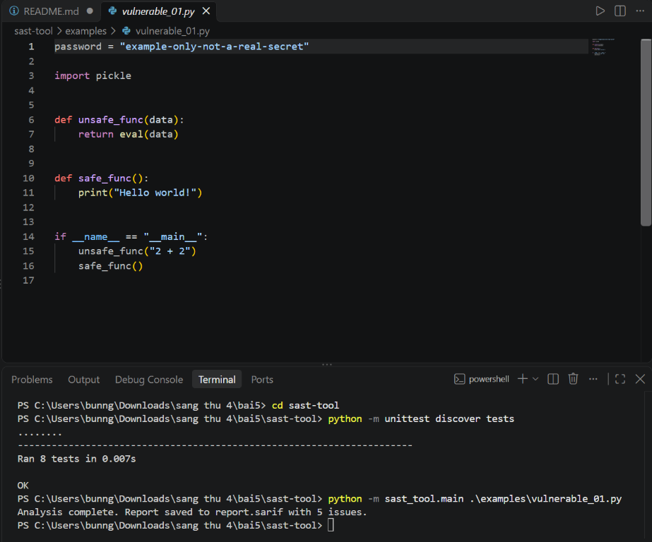
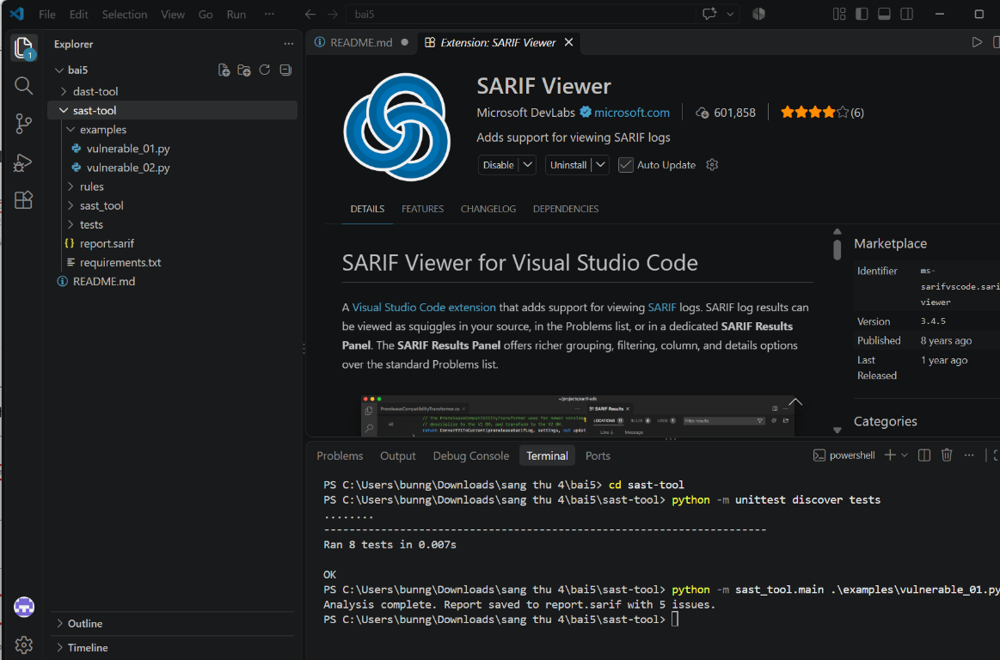
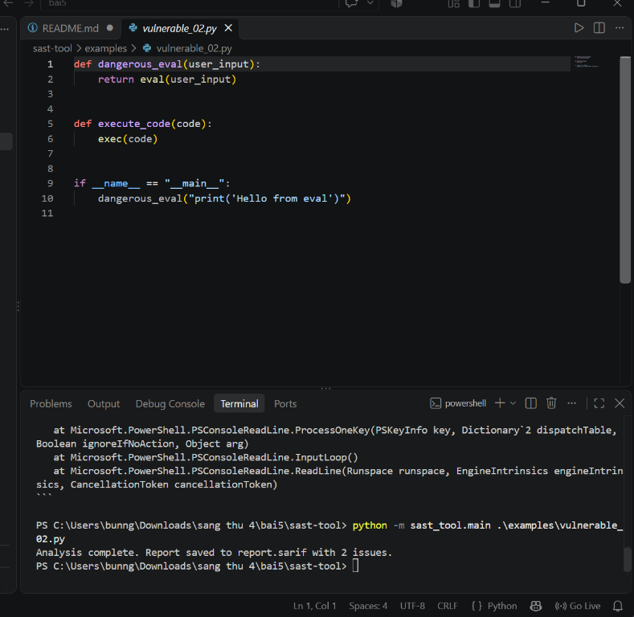
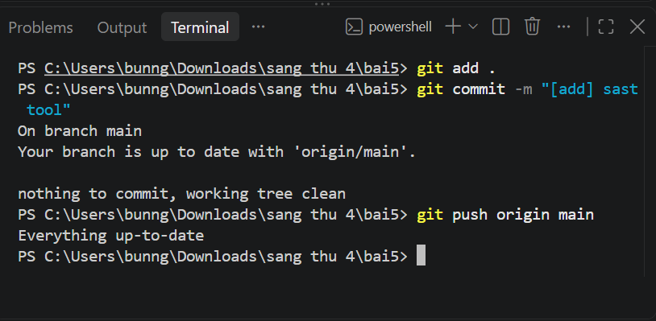
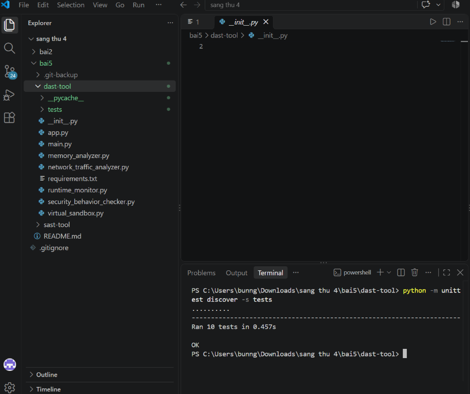
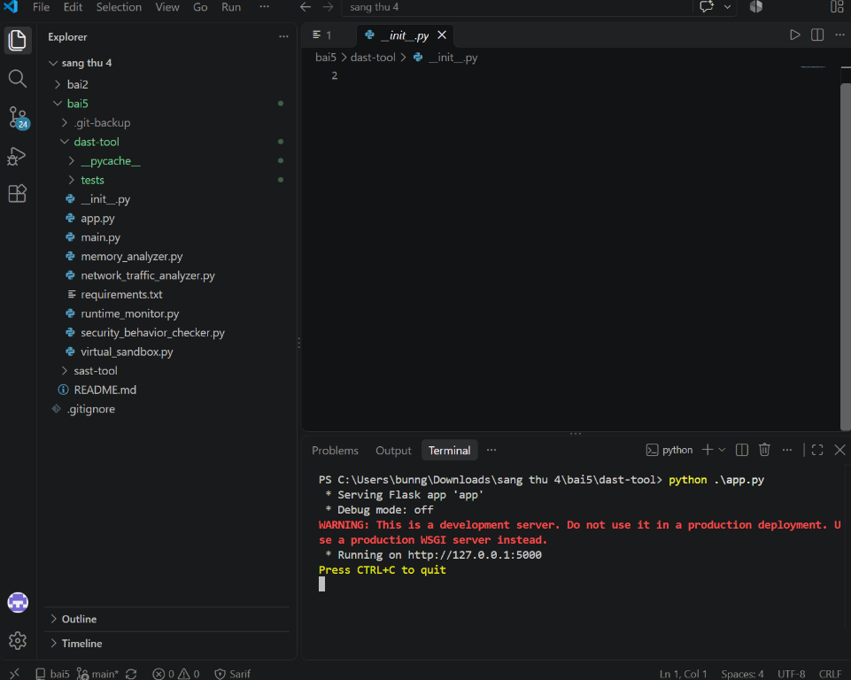

# Bài 5 - DAST và SAST

Tài liệu này hướng dẫn chạy các bước theo đúng thứ tự trong ảnh: quét mã bằng SAST, xem báo cáo SARIF, chạy DAST, rồi đẩy dự án lên GitHub.

## Chuẩn bị

- Cài Python 3.10 trở lên và Git.
- Mở PowerShell tại thư mục `bai5`:

```powershell
cd "C:\Users\bunng\Downloads\sang thu 4\bai5"
```

Nếu terminal đang ở thư mục gốc `sang thu 4`, chạy `cd .\bai5` trước.

## 1. Chạy test và quét file SAST đầu tiên

Vào thư mục SAST, cài dependencies, chạy tests và phân tích file ví dụ:

```powershell
cd .\sast-tool
python -m pip install -r requirements.txt
python -m unittest discover -s tests
python -m sast_tool.main .\examples\vulnerable_01.py --report .\report.sarif
```

Tests thành công sẽ kết thúc bằng `OK`. Lệnh quét tạo/cập nhật `report.sarif` và in số lượng vấn đề tìm thấy. File ví dụ có các mẫu không an toàn để minh họa, không dùng mã này làm ví dụ cho ứng dụng thật.



## 2. Xem báo cáo SARIF trong VS Code

1. Cài extension **SARIF Viewer** trong VS Code.
2. Mở file `sast-tool\report.sarif`.
3. Nếu VS Code chưa tự mở báo cáo, nhấn phải vào file, chọn **Open With...** rồi chọn **SARIF Viewer**.



## 3. Quét ví dụ SAST thứ hai

Vẫn ở thư mục `sast-tool`, chạy:

```powershell
python -m sast_tool.main .\examples\vulnerable_02.py --report .\report.sarif
```

Ví dụ này minh họa `eval` và `exec`. Lệnh sẽ cập nhật `report.sarif` bằng kết quả quét file thứ hai.



## 4. Kiểm tra trạng thái Git

Repo Git nằm ở thư mục gốc `sang thu 4`. Có thể chạy lệnh Git từ `bai5` hoặc thư mục con:

```powershell
git status
git add .
git commit -m "[add] sast tool"
git push origin main
```

Trong ảnh, `nothing to commit, working tree clean` nghĩa là không có thay đổi mới để commit; `Everything up-to-date` nghĩa là GitHub đã có commit mới nhất. Đây là trạng thái bình thường, không phải lỗi. Nếu vừa chạy bước quét và `report.sarif` có thay đổi, hãy kiểm tra `git status` để xác nhận file cần cập nhật.



## 5. Chạy unit tests của DAST

Quay về `bai5` rồi vào thư mục DAST:

```powershell
cd ..
cd .\dast-tool
python -m pip install -r requirements.txt
python -m unittest discover -s tests
```

Kết quả thành công sẽ hiện `Ran 10 tests` và `OK`.



## 6. Chạy DAST trên terminal

Tại thư mục `dast-tool`, chạy:

```powershell
python .\main.py
```

Chương trình in thông tin tiến trình hiện tại, CPU, bộ nhớ, file đang mở, thống kê mạng, kết quả kiểm tra và sandbox.


## 7. Khởi chạy Flask API của DAST (tùy chọn)

Nếu muốn khởi chạy web API thay vì chương trình terminal:

```powershell
python .\app.py
```

Mở `http://127.0.0.1:5000` trên trình duyệt để kiểm tra server. Các endpoint có sẵn là `/api/monitor`, `/api/memory`, `/api/network`, `/api/security`; endpoint `/api/sandbox` nhận POST JSON có trường `command`. Dừng server bằng `Ctrl+C`. Đây là server phục vụ phát triển, không dùng làm server production.



## 8. Đẩy commit lên GitHub

Dừng Flask bằng `Ctrl+C` nếu nó còn chạy. Sau đó, từ thư mục `dast-tool` hoặc thư mục khác bên trong repo:

```powershell
git status
git add .
git commit -m "[add] update bai 5"
git push origin main
```

Ảnh cho thấy một lần push thành công tới nhánh `main`. Nếu Git báo `nothing to commit` hoặc `Everything up-to-date`, nghĩa là hiện không có commit mới cần gửi. Đừng tạo thay đổi giả chỉ để lệnh push in thêm nội dung.


Repository: [Punnicolai/ThucHanhSangThu4](https://github.com/Punnicolai/ThucHanhSangThu4)
