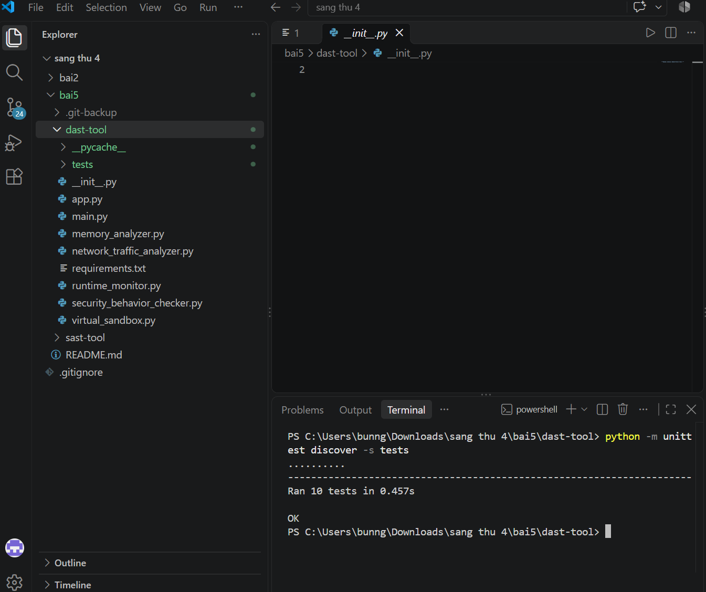
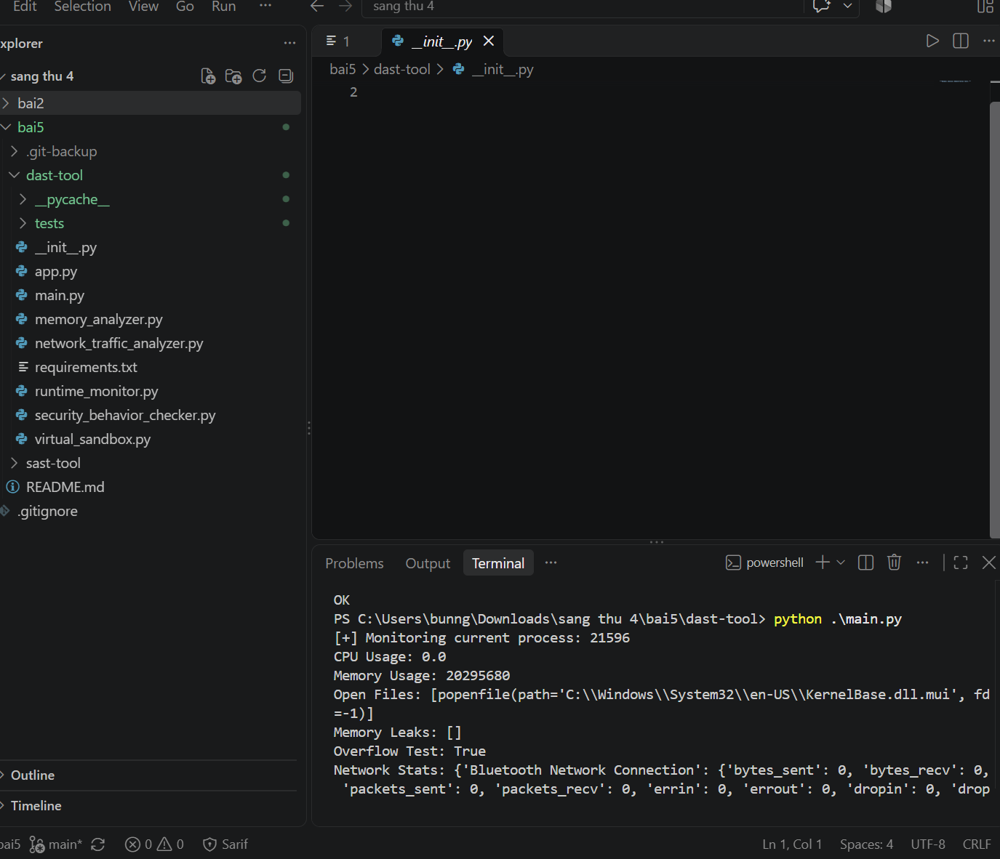
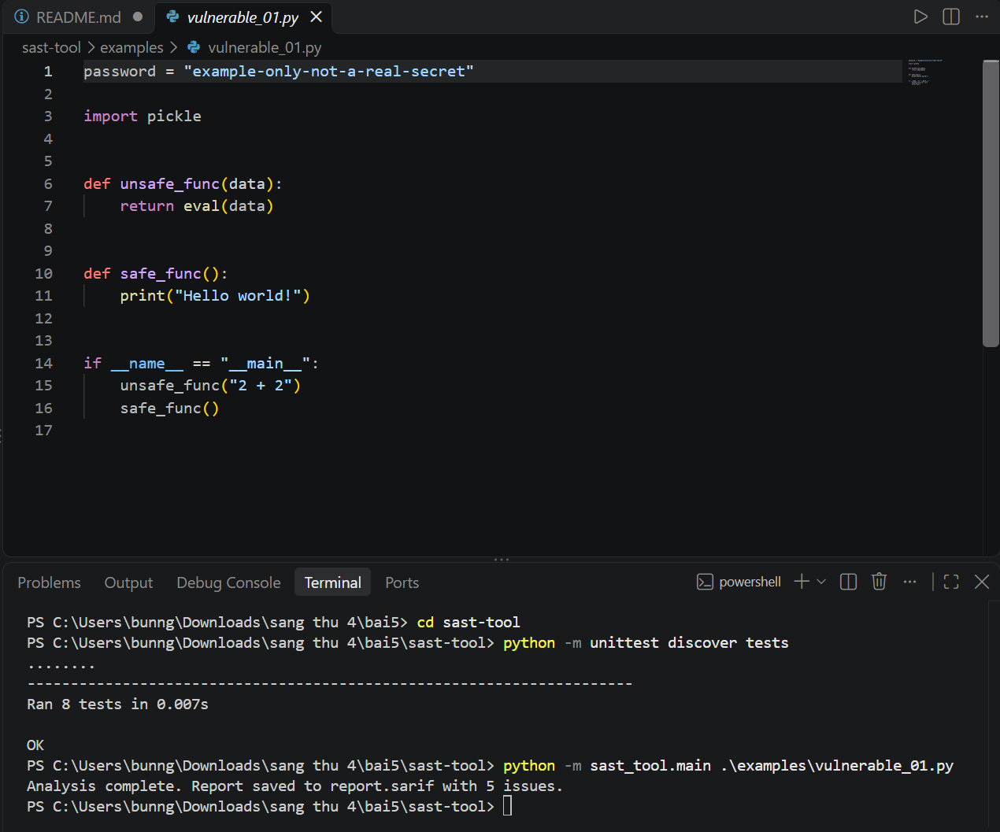
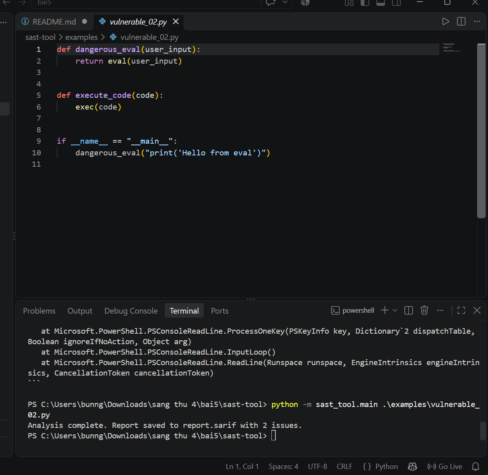
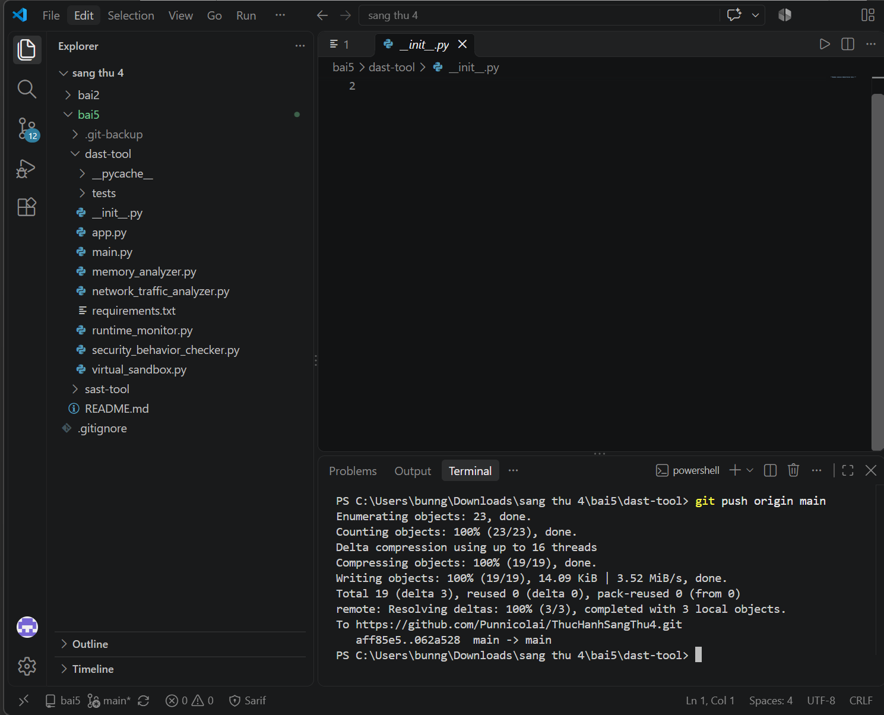

# Bai 5 - DAST va SAST

Tai lieu nay huong dan cai dat, chay thu va xem ket qua hai cong cu phan tich bao mat trong bai 5:

- **DAST tool**: theo doi hanh vi runtime, kiem tra bo nho/mang va chay thu trong sandbox.
- **SAST tool**: phan tich ma Python, phat hien mot so mau khong an toan va xuat bao cao SARIF.

## 1. Yeu cau

- Python 3.10 tro len.
- PowerShell tren Windows (hoac terminal tuong duong).
- VS Code la tuy chon; cai extension **SARIF Viewer** neu muon xem report trong VS Code.

Mo terminal tai thu muc `bai5`:

```powershell
cd "C:\Users\bunng\Downloads\sang thu 4\bai5"
```

Neu ban dang o thu muc goc `sang thu 4`, chay `cd .\bai5` thay cho lenh tren.

## 2. Chay DAST tool

### 2.1 Cai dat dependencies

```powershell
cd .\dast-tool
python -m pip install -r requirements.txt
```

### 2.2 Chay unit tests

```powershell
python -m unittest discover -s tests
```

Ket qua thanh cong co dang `Ran 10 tests` va `OK`.



### 2.3 Chay phan tich runtime tren terminal

```powershell
python .\main.py
```

Chuong trinh in thong tin tien trinh, CPU, bo nho, file dang mo, thong ke mang, ket qua kiem tra va sandbox.



### 2.4 Chay Flask API (tuy chon)

```powershell
python .\app.py
```

Server chay tai `http://127.0.0.1:5000`. Cac endpoint GET gom `/api/monitor`, `/api/memory`, `/api/network`, `/api/security`; endpoint POST `/api/sandbox` nhan JSON co truong `command`. Dung server bang `Ctrl+C`.


## 3. Chay SAST tool

Mo terminal moi tai `bai5`, hoac neu dang o `dast-tool` thi chay `cd ..` de quay ve `bai5`. Sau do:

```powershell
cd .\sast-tool
python -m pip install -r requirements.txt
```

### 3.1 Chay unit tests

```powershell
python -m unittest discover -s tests
```

### 3.2 Quet file mau thu nhat

```powershell
python -m sast_tool.main .\examples\vulnerable_01.py --report .\report.sarif
```

File mau minh hoa cac mau nhu `eval`, `pickle` va chuoi password gia lap; day la ma demo, khong chay ma khong dang tin cay. Ket qua duoc ghi vao `report.sarif`.



### 3.3 Quet file mau thu hai

```powershell
python -m sast_tool.main .\examples\vulnerable_02.py --report .\report.sarif
```

File mau nay minh hoa `eval` va `exec`. So luong canh bao hien thi phu thuoc vao noi dung file va cac rule hien tai.



### 3.4 Xem bao cao SARIF trong VS Code

1. Cai extension **SARIF Viewer** tu VS Code Marketplace.
2. Chay lenh quet SAST nhu tren de tao/cap nhat `report.sarif`.
3. Mo `report.sarif` trong VS Code. Neu can, bam phai vao file va chon **Open With...** > **SARIF Viewer**.
4. Xem ket qua theo finding, file va dong ma.


## 4. Day thay doi len GitHub

Repo Git nam o thu muc goc `sang thu 4`, nen cac lenh Git co the chay tu `bai5` hoac thu muc con cua no. Sau khi sua/tao file:

```powershell
git status
git add .
git commit -m "[add] update bai 5"
git push origin main
```

Neu `git status` hien `nothing to commit, working tree clean` thi khong co thay doi moi de commit. Neu push hien `Everything up-to-date` thi GitHub da co commit moi nhat; day khong phai loi.




Repository: [Punnicolai/ThucHanhSangThu4](https://github.com/Punnicolai/ThucHanhSangThu4)
