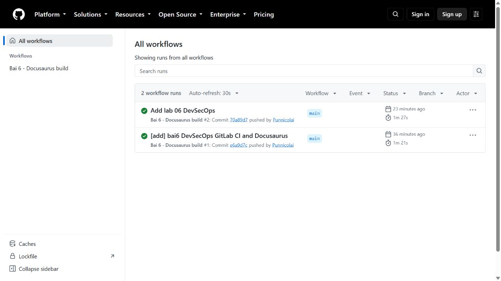
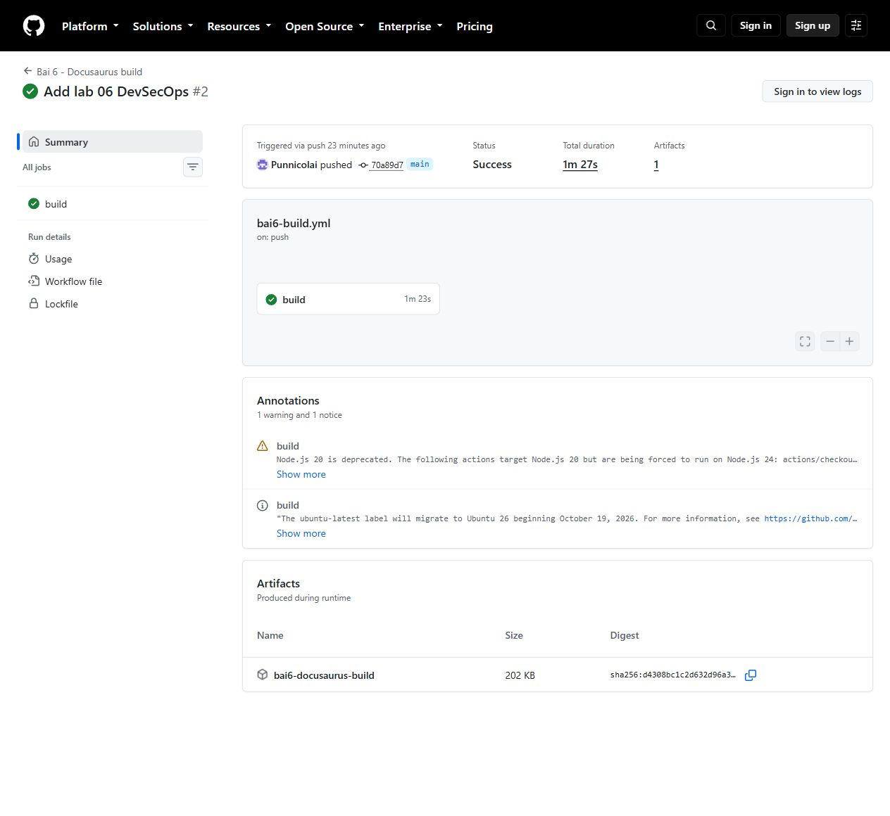
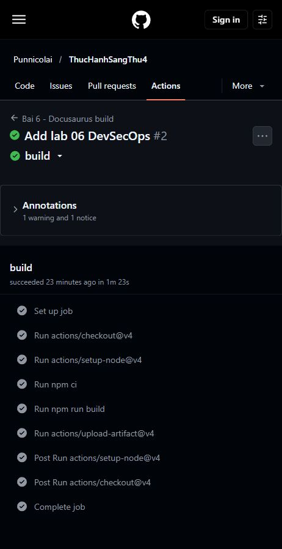

# Bài 6 - Bảo mật với DevSecOps

Báo cáo thao tác và minh chứng thực tế ngày 28/10/2026. Mã nguồn đặt trong `bai6/` của kho [Punnicolai/ThucHanhSangThu4](https://github.com/Punnicolai/ThucHanhSangThu4).

## Trạng thái thực hiện

Đã có mã Docusaurus, các cấu hình GitLab theo từng bước và một workflow GitHub Actions build thành công. Các ảnh bên dưới được chụp trực tiếp từ lần chạy GitHub thật, không phải ảnh minh họa hay ảnh dựng.

Phần thực hành GitLab đang chờ hoàn tất xác minh tài khoản bằng điện thoại/CAPTCHA. Vì vậy báo cáo chưa có minh chứng pipeline GitLab hoặc trang GitLab Pages. Kết quả GitHub Actions không thay thế kết quả GitLab trong đề.

## 1. Mở thư mục và kiểm tra mã nguồn

Mở PowerShell:

```powershell
cd "C:\Users\bunng\Downloads\sang thu 4\bai6"
Get-ChildItem -Force
node -v
npm.cmd -v
```

Các tệp chính gồm `.gitlab-ci.yml`, `package.json`, `package-lock.json`, `docusaurus.config.js`, `sidebars.js`, `docs/` và `src/`.
Dùng Node.js 22 để đồng nhất với pipeline.

## 2. Cài thư viện và build tại máy

```powershell
npm.cmd ci
npm.cmd run build
```

Khi thành công, Docusaurus tạo thư mục `build/` và thông báo `Generated static files in "build"`.
Không commit `node_modules/`, `build/` hoặc `.docusaurus/`.

Để xem website tại máy:

```powershell
npm.cmd run serve
```

Mở địa chỉ được terminal hiển thị. Dừng server bằng Ctrl+C.

## 3. Kiểm tra pipeline GitHub đã chạy

1. Mở kho GitHub.
2. Chọn tab **Actions**.
3. Chọn workflow **Bai 6 - Docusaurus build**.
4. Mở lần chạy **Add lab 06 DevSecOps #2**.

Ảnh thật cho thấy hai lần chạy thành công. Lần chạy số 2 gắn với commit `70a89d7` trên nhánh `main`.



## 4. Xem kết quả build và artifact

Trang Summary của [lần chạy số 2](https://github.com/Punnicolai/ThucHanhSangThu4/actions/runs/40613912972) hiển thị:

- Status: **Success**.
- Tổng thời gian: **1m 27s**.
- Job `build`: **1m 23s**.
- Một artifact tên `bai6-docusaurus-build`, kích thước **202 KB**.



## 5. Xem các bước bên trong job build

Nhấn job **build**. Workflow thực hiện checkout mã, thiết lập Node.js, chạy `npm ci`, `npm run build`, rồi upload artifact.



Tệp workflow nằm tại `.github/workflows/bai6-build.yml` ở gốc kho. GitHub chạy workflow này; GitHub không chạy `.gitlab-ci.yml`.

## 6. Thực hiện pipeline GitLab cơ bản theo phần 6.2.1

Phần này là hướng dẫn thao tác, chưa có ảnh kết quả GitLab.

1. Hoàn tất xác minh tài khoản GitLab.
2. Tạo một dự án `lab-06` và ghi lại URL thực tế. Nếu tạo trong group thì URL có namespace của group.
3. Trong Code > Repository, tạo `.gitlab-ci.yml` bằng nội dung `examples/01-basic.yml`.
4. Commit vào nhánh mặc định.
5. Mở Build > Pipelines, chọn pipeline vừa chạy.
6. Kiểm tra ba stage build, test, deploy; bốn job build-job, test-job1, test-job2, deploy-prod.
7. Mở log deploy-prod và test-job2 để chụp minh chứng.

Hai job test có thể chạy song song nếu đủ runner. `sleep 20` mô phỏng job dài. Deploy ở ví dụ cơ bản chỉ in thông báo, chưa triển khai website.

## 7. Thực hiện Docusaurus trên GitLab theo phần 6.2.2

1. Đưa nội dung bài 6 lên gốc dự án GitLab; không đặt thêm một lớp thư mục `bai6` nếu dùng nguyên cấu hình đi kèm.
2. Thay `.gitlab-ci.yml` bằng nội dung `examples/02-first-job.yml`, commit rồi xem log câu chào và ngày giờ.
3. Thay bằng `examples/03-build.yml`, commit rồi xem log build và Browse artifacts.
4. Khôi phục cấu hình `.gitlab-ci.yml` cuối của bài, gồm build-job và pages.
5. Commit, đợi hai job thành công.
6. Vào Deploy > Pages và mở URL thực tế GitLab cấp.

Cấu hình dùng `npm ci` cùng lockfile. Job build lưu `build/`; job Pages nhận artifact, chuyển thành `public/` và xuất bản bằng `pages.publish`. Chỉ nhánh mặc định được publish.
`docusaurus.config.js` lấy `CI_PAGES_URL` để xác định url/baseUrl, hỗ trợ cả domain riêng của Pages và đường dẫn dự án.

Nếu job Pending, kiểm tra runner trong Settings > CI/CD > Runners và hạn mức compute. Nếu GitLab yêu cầu xác minh bổ sung, chủ tài khoản cần hoàn tất.

## 8. Bảo mật trong pipeline

- Phân quyền tối thiểu, bật MFA, bảo vệ nhánh mặc định và duyệt merge request.
- Lưu token trong kho biến bí mật của CI; không ghi token vào mã, log hoặc ảnh báo cáo.
- SAST quét mã; SCA quét dependency; DAST kiểm tra ứng dụng trong môi trường kiểm thử; secret scan tìm khóa bị lộ.
- Security gate cần chặn deploy khi có lỗi vượt ngưỡng. Ví dụ `examples/04-audit.yml` bổ sung `npm audit --omit=dev --audit-level=high` vào stage test.
- Kiểm tra IaC bằng Checkov/Trivy khi dự án có cấu hình IaC. Bài hiện chưa tạo hạ tầng bằng IaC.

Pipeline mặc định chỉ build/deploy website; chưa tích hợp đầy đủ SAST, DAST, secret scan, ký artifact hoặc kiểm tra IaC.

## 9. Đẩy báo cáo lên GitHub

Từ gốc kho:

```powershell
cd "C:\Users\bunng\Downloads\sang thu 4"
git status
git add -- bai6/README.md bai6/docs/images
git commit -m "[docs] add bai6 walkthrough with real screenshots"
git push origin main
```

Ảnh chụp lưu tại `bai6/docs/images/` và được nhúng trực tiếp trong README như bài 5.

## Minh chứng GitLab còn cần bổ sung

- Pipeline cơ bản đủ bốn job và log deploy-prod.
- Job đầu tiên với câu chào và ngày giờ.
- Build Docusaurus thành công và nội dung artifact.
- Pipeline cuối build/deploy thành công.
- Website truy cập được từ URL GitLab Pages.

## Tài liệu đối chiếu

- [GitLab CI/CD YAML](https://docs.gitlab.com/ci/yaml/)
- [GitLab Pages](https://docs.gitlab.com/user/project/pages/)
- [Docusaurus installation](https://docusaurus.io/docs/installation)
